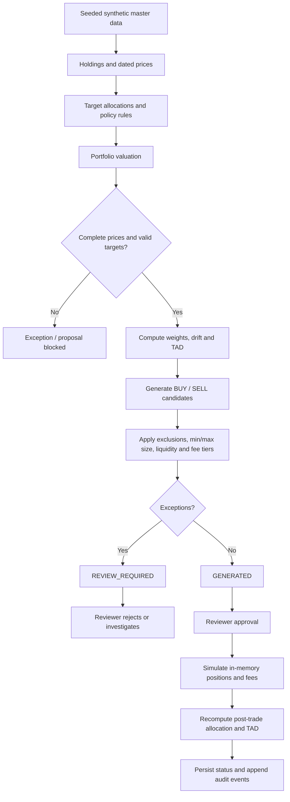

# Solution architecture

## Components

- **SQLite persistence:** ten required business tables plus append-only `entity_event`.
- **Synthetic generator:** fixed-seed master-first generation; parent IDs are created before dependent records.
- **Portfolio service:** date-aware market-price lookup, holding valuation, asset-class weights, drift and TAD.
- **Policy service:** effective-dated constraints, fee-band selection and deterministic fee calculation.
- **Rebalance service:** target-vs-current notional, BUY/SELL sizing, sell caps, exception handling, proposal persistence and post-trade simulation.
- **FastAPI:** read, propose, review, simulate and audit endpoints.
- **Validation/reproducibility scripts:** row-level and cross-row integrity, negative-scenario evaluation, checksum/row-count/PK-sequence comparison.

## Processing flow

## Key design choices

1. Deterministic rules decide trades; no LLM can override a constraint.
2. Decimal strings are used for SQLite financial fields; calculations use Python `Decimal`.
3. Missing prices are never invented. Stale prices are exceptions and block trades for the affected instrument.
4. Trade proposals do not update source holdings. Simulation uses an in-memory copy and deducts fees from cash.
5. Proposal/trade lifecycle transitions are guarded by SQLite triggers. `entity_event` rejects UPDATE and DELETE.
6. The baseline data generator rebuilds the database file for a clean deterministic dataset. This is an explicit dataset reset, not an operational database migration.
7. The demo API has no authentication layer; approval endpoints model the reviewer workflow but are not production security controls.
