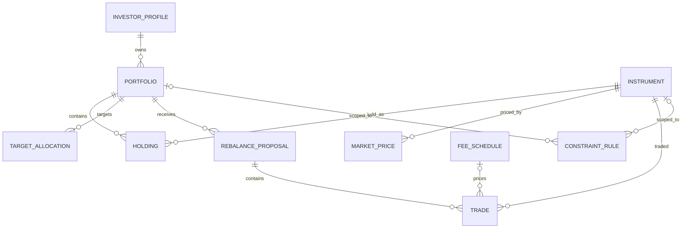

# Entity relationship diagram

`entity_event` is a polymorphic audit log linked to several entity types by `(entity_type, entity_id)`; it is omitted from the ER diagram because that relationship cannot be expressed as one ordinary FK.
